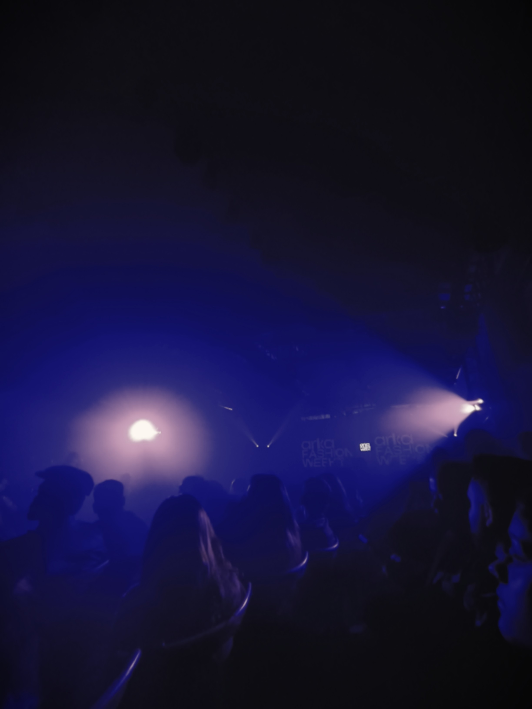
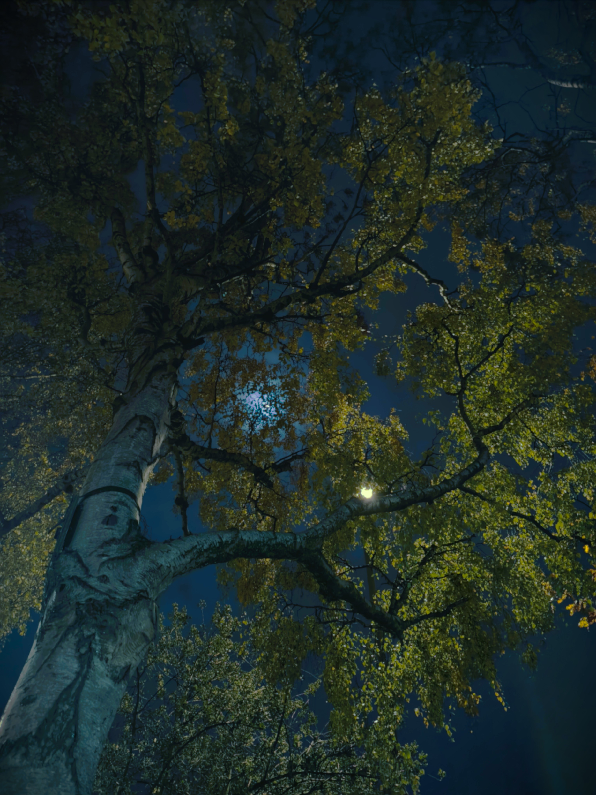
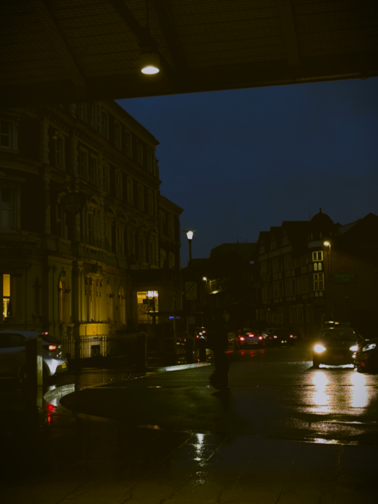

<!--Header-->

  

<h1 align="center">
  <samp>‹ MAISHA KADER / ›</samp>
</h1>

  <samp>SOFTWARE ENGINEERING STUDENT · DEVELOPER IN PROGRESS</samp>

  <i>Building. Learning. Experimenting.</i>

<!--About-->
<h3 align="center">
  <samp>‹ 01 / ABOUT ME / ›</samp>
</h3>

Hey! I'm Maisha, a second-year Software Engineering student at the **University of Chester**.

I'm interested in software development, problem-solving and creating things that are both functional and thoughtfully designed.

- Currently developing my skills in C++ and web development.
- Interested in software engineering, databases and UI/UX.
- Always working on something new.

---
<!--Tech Stack -->
<h3 align="center">
  <samp>‹ 02 / TECH STACK / ›</samp>
</h3>

**Languages**

`Python` &nbsp; `Java` &nbsp; `SQL` &nbsp; `C++` &nbsp; `HTML` &nbsp; `CSS` &nbsp; `JavaScript`

**Tools**

`IntelliJ IDEA` &nbsp; `PyCharm` &nbsp; `CLion` &nbsp; `SSMS` &nbsp; `Figma` &nbsp; `GitHub` 

---
<!--Projects-->
<h3 align="center">
  <samp>‹ 03 / SELECTED PROJECTS / ›</samp>
</h3>

| PROJECT | DESCRIPTION | TECHNOLOGIES |
|:---|:---|:---|
| Restaurant Database | Designed and implemented a relational database for a restaurant ordering system for a university project. | SQL Server |
| Rock Paper Scissors | Built a GUI game with a live scoreboard (wins, losses and draws), round results and a reset button. | Python, Tkinter |
| Banking System | Developed a university banking system project. | Java |
| Java Calculator | Built a GUI calculator with a button grid, live expression display, last-answer recall and divide-by-zero handling. | Java, Swing GUI |

---
<!--Currently Exploring-->
<h3 align="center">
  <samp>‹ 04 / CURRENTLY EXPLORING / ›</samp>
</h3>

- Data Structures and Algorithms
- C++ programming
- Front-end development
- Software testing

---
<!--Hobbies-->
<h3 align="center">
  <samp>‹ 05 / BEYOND THE CODE / ›</samp>
</h3>

Beyond the code, I am someone who loves exploring the world, discovering new places and experiencing different cultures. I also enjoy stepping outside my comfort zone, learning from new experiences and capturing little moments through photography.

  <i>All photographs on this profile are my original work - shot and edited by me! Please ask before reusing :)</i>

---
<!-- Footer-->

  <samp>━━━━━━━━ LET'S CONNECT ━━━━━━━━</samp>
    
  <a href="https://github.com/maisha-kader">GITHUB</a>
  &nbsp; · &nbsp;
  <a href="https://www.linkedin.com/in/maisha-kader">LINKEDIN</a>

  © 2026 MAISHA KADER.

